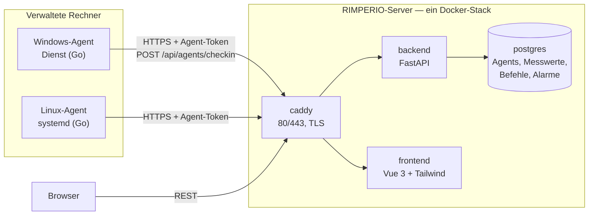

<div align="center">


# RIMPERIO

**Ein schlankes, selbst-gehostetes Remote Monitoring &amp; Management —
Rechner sehen, überwachen und aus der Ferne steuern. Ohne Lizenz, ohne Cloud.**

In der Tradition von [Tactical RMM](https://docs.tacticalrmm.com/), im Stil von
[LogBot](https://github.com/Phydran6/Logbot): ein Docker-Stack, ein
Installationsbefehl, eine Oberfläche im Browser — dazu ein Agent für Windows und
Linux, der sich als **signierte `.exe` und `.msi`** ausliefern lässt.

[](LICENSE)
[](backend)
[](frontend)
[](agent)
[](caddy)

</div>

---

## Wo will ich hin?

| Ich will … | Hier entlang |
|---|---|
| **sofort loslegen** | [Schnellstart](#schnellstart) |
| **verstehen, wie das zusammenhängt** | [Architektur](docs/architektur.md) |
| **einen Rechner anbinden** | [Agent](agent/README.md) · [Installer &amp; Signatur](installer/README.md) |
| **wissen, warum Virenscanner anschlagen können** | [Signatur &amp; Virenscanner](installer/README.md#ehrliche-vorbemerkung-von-jedem-antivirus-als-ok) |
| **die Oberfläche bedienen** | [Bedienung](docs/bedienung.md) |
| **selbst entwickeln** | [Backend](backend/README.md) · [Frontend](frontend/README.md) · [Agent](agent/README.md) |

---

## Was RIMPERIO kann

| | |
|---|---|
| **Rechner sehen** | Inventur je Agent: OS, CPU, RAM, Platten, Netz, Laufzeit, Agent-Version |
| **Überwachen** | Live-Werte im Takt (CPU/RAM/Platte), Verlauf als Mini-Diagramm |
| **Alarmieren** | Schwellen für CPU/RAM/Platte und „offline" — Alarme lösen sich selbst wieder auf |
| **Fernsteuern** | Befehle an einen Agent schicken: PowerShell, CMD, Bash oder sh — mit Ausgabe und Rückgabecode |
| **Verwalten** | Benutzer mit Rollen (admin/operator/readonly), Standorte, Enrollment-Geheimnis — alles im Browser |
| **Ausliefern** | Agent als signierte `.exe` und `.msi`; ein Build-/Signier-/Release-Weg liegt bei |

---

## Die Bausteine



<sub>Der Agent **holt** im Takt seine Aufgaben ab (Pull) — es muss kein Weg von
außen auf den Rechner offen sein. Genau wie beim LogBot-Agent: HTTPS mit
`Authorization: Bearer &lt;AGENT-TOKEN&gt;`.</sub>

| Verzeichnis | Was drin ist | Technik |
|---|---|---|
| [`backend/`](backend) | API, Auth, Enrollment, Check-in, Alarme, Benutzer | FastAPI, SQLAlchemy, PostgreSQL |
| [`frontend/`](frontend) | Oberfläche: Dashboard, Agents, Alarme, Einstellungen | Vue 3, Tailwind, Vite |
| [`agent/`](agent) | der Agent für Windows &amp; Linux (ein Binary) | Go, gopsutil, kardianos/service |
| [`installer/`](installer) | `.exe`/`.msi` bauen, signieren, verteilen | WiX v4, PowerShell, signtool |
| [`caddy/`](caddy) | Reverse Proxy und TLS | Caddy 2 |
| [`deploy/`](deploy) | Betriebshinweise, Varianten | Docker Compose |
| [`docs/`](docs) | Architektur, Bedienung | Markdown |

---

## Download

Fertige Agent-Dateien (Windows `.exe` und `.msi`, Linux amd64/arm64) gibt es unter
**[Releases](https://github.com/Phydran6/RIMPERIO-Server/releases/latest)**.
Sie werden ausschließlich von GitHub Actions aus diesem Quellcode gebaut.

*Free code signing provided by [SignPath.io](https://about.signpath.io/),
certificate by [SignPath Foundation](https://signpath.org/).*
Details: [Code signing policy](#code-signing-policy).

---

## Schnellstart

**Server** — auf einem Linux-Host mit Root:

```bash
curl -sSL https://raw.githubusercontent.com/Phydran6/RIMPERIO-Server/main/install.sh | sudo bash
```

Danach:

- **Oberfläche:** `http://SERVER-IP/` — Anmeldung `admin` / `admin` *(sofort ändern)*
- **API-Doku:** `http://SERVER-IP/api/docs`
- **HTTPS:** in `.env` `RIMPERIO_SITE_ADDRESS=deine-domain.de` setzen, dann `docker compose up -d`

**Agent anbinden** — in der Oberfläche unter *Agents → Agent hinzufügen* steht der
fertige Befehl mit eingesetztem Server und Geheimnis. Windows, kurz:

```powershell
& ([scriptblock]::Create((irm https://raw.githubusercontent.com/Phydran6/RIMPERIO-Server/main/installer/windows/install-agent.ps1))) `
  -Server https://rmm.example.de -Secret DEIN_ENROLL_GEHEIMNIS
```

→ Alle Wege (MSI, Linux, Signatur): [Installer &amp; Signatur](installer/README.md)

---

## Lokal entwickeln

```bash
# Server-Stack
cp .env.example .env
docker compose up -d --build
docker compose logs -f backend

# Agent (ohne Dienst, ein Testdurchlauf)
cd agent
go run ./cmd/rimperio-agent enroll -server http://localhost -secret <ENROLL> -insecure
go run ./cmd/rimperio-agent once

# Frontend (Hot Reload gegen das Backend auf :8000)
cd frontend && npm install && npm run dev
```

---

## Projektstand

| | |
|---|---|
| **Versionsschema** | `JAHR.MONAT.TAG.STUNDE.MINUTE.SEKUNDE` — [`VERSION`](VERSION) |
| **Lizenz** | [MIT](LICENSE) |
| **Referenzen** | Vorbild [Tactical RMM](https://docs.tacticalrmm.com/), Geschwister-Projekt [LogBot](https://github.com/Phydran6/Logbot) |

> **Ehrlich zur „von jedem Antivirus als OK"-Frage:** garantieren kann das
> niemand. Der seriöse Weg ist echtes Code Signing + sauberer Build +
> Fehlalarm-Meldung — und genau den geht RIMPERIO. Keine Tarnung, keine Umgehung.
> Einzelheiten: [installer/README.md](installer/README.md).

---

## Code signing policy

*Die Signier-Richtlinie steht auf Englisch, weil die SignPath Foundation sie so
verlangt und prüft.*

Free code signing provided by [SignPath.io](https://about.signpath.io/),
certificate by [SignPath Foundation](https://signpath.org/).

Signed artifacts (`rimperio-agent.exe`, `rimperio-agent.msi`) are built
exclusively from this repository's source code by the GitHub Actions workflow
[`agent-release.yml`](.github/workflows/agent-release.yml) on GitHub-hosted
runners. Every release signing request is approved manually.

### Team roles

| Role | Members |
|---|---|
| Committers and reviewers | [Phydran6](https://github.com/Phydran6) |
| Approvers | [Phydran6](https://github.com/Phydran6) |

Changes from contributors outside the team are reviewed by a committer before
they are merged.

### Privacy policy

This program will not transfer any information to other networked systems
unless specifically requested by the user or the person installing or operating
it. The RIMPERIO agent communicates **only** with the RIMPERIO server whose
address is configured during installation (`SERVER=…`). That server is operated
by the person or organization that installed the agent, not by this project. The
agent sends system and inventory data (hardware, operating system, installed
software, update status, check results) and runs tasks issued from that server.
No data is sent to the RIMPERIO authors or any other third party.

### Uninstall

Remove *RIMPERIO Agent* via *Settings → Apps* (or
`msiexec /x rimperio-agent.msi`). Without the MSI, run `rimperio-agent uninstall`
as administrator (removes service and configuration), then delete
`C:\Program Files\RIMPERIO Agent\`. On Linux: `sudo rimperio-agent uninstall &&
sudo rm /usr/local/bin/rimperio-agent`. See
[installer/README.md](installer/README.md#deinstallieren).

<div align="center">
<sub>Entwickelt von <a href="https://github.com/Phydran6">Phydran6</a></sub>
</div>
