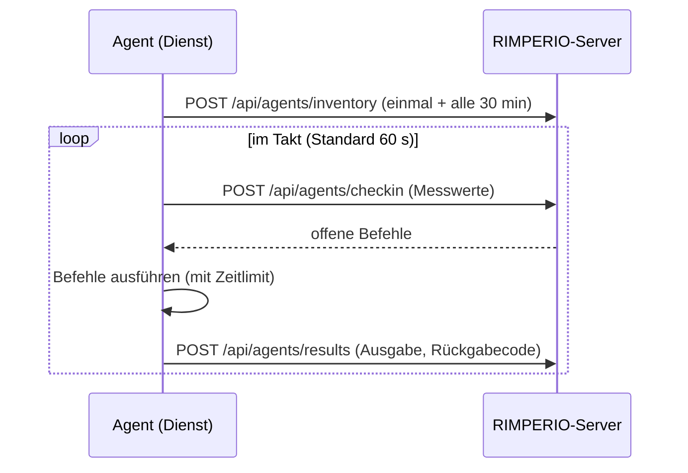

# Agent

Der RIMPERIO-Agent — ein einzelnes Go-Binary, das als Systemdienst läuft, sich im
Takt beim Server meldet, Messwerte und Inventur schickt und mitgegebene Befehle
ausführt.

← [Übersicht](../README.md) · [Installer &amp; Signatur](installer/README.md) · [Fernwartung](../docs/rmm/README.md)

---

## Auf einen Blick

| | |
|---|---|
| **Sprache** | Go (ein statisches Binary, kein Runtime nötig) |
| **Dienst** | Windows-Service bzw. systemd/launchd — über [`kardianos/service`](https://github.com/kardianos/service) |
| **Messwerte** | CPU, RAM, Platten, Laufzeit, Top-Prozesse — über [`gopsutil`](https://github.com/shirou/gopsutil) |
| **Weg zum Server** | nur ausgehend: HTTPS + `Authorization: Bearer <AGENT-TOKEN>` |
| **Konfiguration** | `C:\ProgramData\RIMPERIO\agent.json` bzw. `/opt/RMM/rimperio/etc/agent.json` (0600, gehört dem Dienstkonto) |
| **Läuft als** | Windows: `SYSTEM` · Linux: eigenes Dienstkonto (Standard `rimperio`), **nicht root** — siehe [Linux: Dienstkonto statt root](#linux-dienstkonto-statt-root) |
| **Plattformen** | Windows (amd64), Linux (amd64/arm64); baubar auch für macOS |

---

## Was er tut



Der Agent **holt** ab — der Server verbindet sich nie zum Agent. Darum braucht
der Rechner keine offene Tür nach außen.

---

## Befehle

```text
rimperio-agent setup      -server URL -secret SCHLÜSSEL [-site S] [-desc D] [-insecure]
                      Anmelden + Dienst einrichten + starten (manueller Weg).
rimperio-agent bootstrap  -server URL -secret SCHLÜSSEL [...]
                      Nur Konfiguration anlegen (für den MSI-Installer).
rimperio-agent install    Dienst registrieren und starten.
rimperio-agent enroll     -server URL -secret SCHLÜSSEL [...]   Nur anmelden.
rimperio-agent uninstall  [-keep-record]
                      Vom Rechner entfernen und am Server abmelden.
rimperio-agent cleanup    [-keep-record]
                      Nur abmelden + Konfiguration löschen (ruft das MSI).
rimperio-agent start | stop | restart
rimperio-agent once       Ein Testdurchlauf (ohne Dienst) — gut zum Prüfen.
rimperio-agent status
rimperio-agent version
```

`-insecure` schaltet die TLS-Prüfung ab — **nur** fürs Labor mit
Selbstzertifikat, nie in Produktion.

Unter Linux richtet [`install-agent.sh`](installer/linux/install-agent.sh) den Dienst ein;
`setup` und `install` verweisen dort hin. `enroll`, `once` und `run` laufen nie als root:
mit `sudo` gerufen, startet sich der Agent unter seinem Dienstkonto neu.

---

## Linux: Dienstkonto statt root

Der Agent läuft unter einem **eigenen Dienstkonto** (Standard `rimperio`, wählbar mit
`--user`). Fehlt es, legt der Installer es an — als Systemkonto ohne Anmeldung und ohne
Passwort. root als Dienstkonto lehnt er ab. `sudo` braucht nur die Einrichtung selbst.

```bash
curl -sSL https://raw.githubusercontent.com/Phydran6/RIMPERIO-Server/main/agent/installer/linux/install-agent.sh \
  | sudo bash -s -- --server https://rmm.example.de --secret SCHLÜSSEL --site Buero --user rimperio
```

**Alles liegt unter `/opt/RMM/rimperio`:**

| Pfad | Inhalt | Gehört |
|---|---|---|
| `bin/rimperio-agent` | das Programm | root, 0755 |
| `lib/rimperio-helper` | Hilfsskript für Aufgaben, die root brauchen | root, 0755 |
| `etc/agent.json` | Konfiguration mit Agent-Token | Dienstkonto, 0600 |
| `var/` | Arbeitsverzeichnis | Dienstkonto, 0700 |

Außerhalb liegt nur, was systemd und sudo verlangen: `/etc/systemd/system/rimperio-agent.service`
und `/etc/sudoers.d/rimperio-agent`. Der [Log-Agent](logship/README.md) wohnt im selben
Verzeichnis und unter demselben Konto.

**Rechte (`--sudo`).** Was root braucht, geht über das Hilfsskript — die sudo-Regel
erlaubt dem Konto genau dieses eine Skript, und das prüft jede Angabe selbst (nur
Paketnamen, keine Dateien oder Pfade, Minuten als Zahl):

| Stufe | Darf | Befehle aus der Oberfläche |
|---|---|---|
| `limited` *(Standard)* | Paketlisten auffrischen, die freigegebenen Updates einspielen, Neustart, sich selbst deinstallieren | laufen als Dienstkonto, ohne root |
| `full` | zusätzlich `sudo` für alles | dürfen `sudo …` benutzen |
| `none` | nichts davon — keine Updates, kein Neustart aus der Ferne | laufen als Dienstkonto, ohne root |

Jede Aufgabe des Hilfsskripts — auch eine abgelehnte — steht im Journal:
`journalctl -t rimperio-helper`.

Inventur, Messwerte, Checks und die Suche nach Updates brauchen keine Rechte. Docker:
Gibt es die Gruppe `docker`, bekommt der Dienst sie dazu (für Container-Updates — sie ist
so mächtig wie root); `--no-docker` lässt das weg.

**Aktualisieren:** denselben Einzeiler noch einmal — ohne `--secret` geht es auch, die
Anmeldung bleibt. Eine ältere Installation (als root, `/usr/local/bin`, `/etc/rimperio`)
wird dabei übernommen, samt Anmeldung. Lief unter dem Dienstnamen `rimperio-agent` noch
der ältere Log-Agent, heißt er danach `rimperio-log-agent` und läuft weiter.

---

## Anmeldung (Enrollment)

Zwei Wege, dasselbe Ziel:

Der „Secret“ ist ein **Zugangsschlüssel** aus der Oberfläche
(*Verwaltung → Zugang & Sicherheit → Zugangsschlüssel*): am besten eine **Einladung**
(zählbar, läuft ab), alternativ der Generalschlüssel. Dieselben Schlüssel nutzen die
Log-Agents. Die Anmeldung läuft über `POST /api/rmm/agent/enroll`; ein Gerät mit
gleichem Hostnamen (etwa eines, das schon Logs schickt) wird dabei weiterverwendet.

- **Direkt** (`setup`/`enroll`): Der Agent meldet sich sofort mit dem
  Zugangsschlüssel an und bekommt sein persönliches Token.
- **Über die Registry** (MSI): Der Installer legt Server + Schlüssel nach
  `HKLM\SOFTWARE\RIMPERIO\Agent`. Beim **ersten Dienststart** meldet der Agent sich
  selbst an und löscht den Schlüssel danach aus Konfiguration **und** Registry
  (die darf jeder Benutzer lesen). So braucht die MSI-Installation keine
  Netzverbindung. Solange der Agent noch nicht angemeldet ist, gelten die Werte aus
  der Registry — eine Neuinstallation mit korrigierter Adresse greift also sofort.

Das Token wird serverseitig nur als SHA-256 gespeichert — den Klartext sieht der
Server genau einmal, bei der Anmeldung.

---

## Deinstallieren

Standard ist **alles weg**: Agent vom Rechner, Eintrag vom Server. Ein Gerät, das
außerdem Logs schickt, bleibt mit seinen Logs unter *Geräte* stehen.

| Wo | Wie | Eintrag auf dem Server behalten |
|---|---|---|
| Oberfläche | Rechner → *Agent entfernen* → Häkchen „auch auf dem Rechner deinstallieren“ | Häkchen weg = nur der Eintrag geht, der Agent bleibt installiert |
| Windows, MSI | *Einstellungen → Apps* oder `msiexec /x rimperio-agent.msi /qn /norestart` | `KEEP_RECORD=1` |
| Windows, ohne MSI | `rimperio-agent uninstall` (als Administrator) | `-keep-record` |
| Linux | `sudo /opt/RMM/rimperio/bin/rimperio-agent uninstall` | `-keep-record` |

Aus der Oberfläche läuft das so: Der Server reiht den Befehl `uninstall` ein; beim
nächsten Check-in meldet der Agent sich ab (`POST /api/rmm/agent/unregister`) und
entfernt sich — per MSI installiert über den Windows Installer, unter Linux über das
Hilfsskript (es übergibt dafür an eine kurzlebige systemd-Unit, weil das Stoppen des
Dienstes sonst auch das Skript beendete), sonst selbst. Unter Linux gehen dabei auch die
sudo-Regel und — wenn sonst nichts von RIMPERIO darunter läuft — das Dienstkonto, sofern
der Installer es angelegt hat, und `/opt/RMM/rimperio`. Ist der
Rechner aus, wartet der Auftrag, bis er wieder läuft. Ist der Server beim Deinstallieren
am Rechner nicht erreichbar, läuft die Deinstallation trotzdem durch; den Eintrag
entfernt man dann in der Oberfläche.

---

## Bauen

```bash
cd agent

# Schnell, für die aktuelle Plattform
go build -o bin/rimperio-agent ./cmd/rimperio-agent

# Release-artig (klein, getrimmt)
CGO_ENABLED=0 GOOS=windows GOARCH=amd64 go build -trimpath -ldflags "-s -w" -o bin/rimperio-agent.exe ./cmd/rimperio-agent
CGO_ENABLED=0 GOOS=linux   GOARCH=arm64 go build -trimpath -ldflags "-s -w" -o bin/rimperio-agent-linux-arm64 ./cmd/rimperio-agent
```

Mit Versions-Ressource und Signatur fürs .exe/.msi: siehe
[Installer &amp; Signatur](installer/README.md).

---

## Dateien

| Datei | Wofür |
|---|---|
| [`cmd/rimperio-agent/main.go`](cmd/rimperio-agent/main.go) | Kommandozeile und Unterbefehle |
| [`internal/core/runner.go`](internal/core/runner.go) | Dienstschleife, Anmeldung, Dienststeuerung |
| [`internal/core/collect.go`](internal/core/collect.go) | Inventur und Messwerte (gopsutil) |
| [`internal/core/client.go`](internal/core/client.go) | HTTP-Weg zum Server |
| [`internal/core/exec.go`](internal/core/exec.go) | Befehle ausführen (Shell, Zeitlimit) |
| [`internal/core/config.go`](internal/core/config.go) | Konfiguration lesen/schreiben |
| [`internal/core/privileged_linux.go`](internal/core/privileged_linux.go) | Linux: Aufgaben mit root über das Hilfsskript, nie als root laufen |
| [`installer/linux/install-agent.sh`](installer/linux/install-agent.sh) | Linux-Installer: Dienstkonto, `/opt/RMM/rimperio`, sudo-Regel, Hilfsskript |
| [`internal/core/bootstrap_windows.go`](internal/core/bootstrap_windows.go) | Registry-Bootstrap für das MSI |
