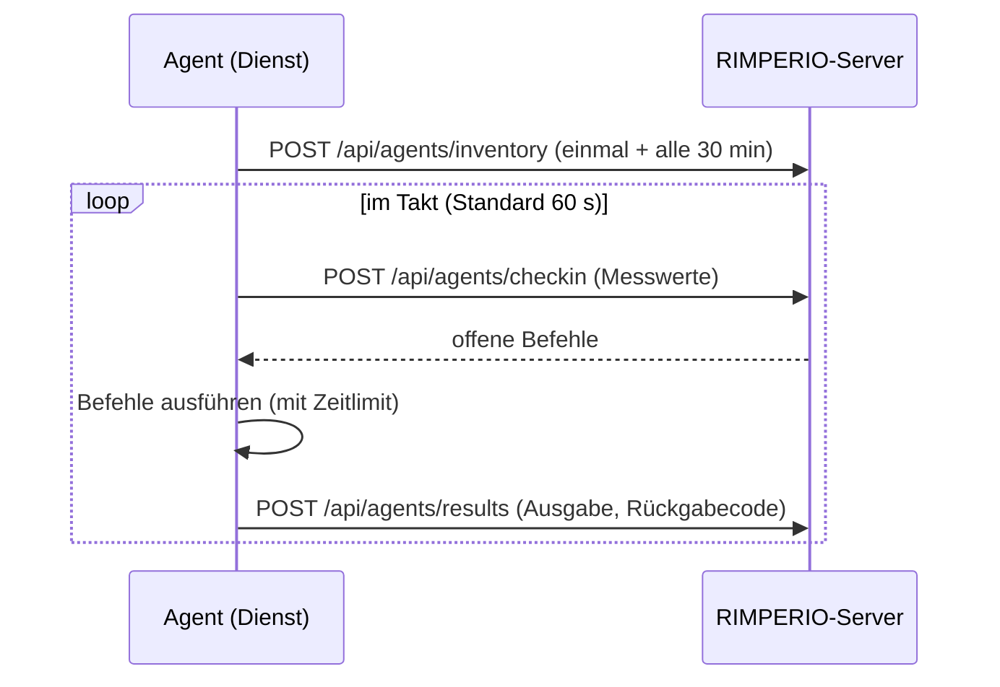

# Agent

Der RIMPERIO-Agent — ein einzelnes Go-Binary, das als Systemdienst läuft, sich im
Takt beim Server meldet, Messwerte und Inventur schickt und mitgegebene Befehle
ausführt.

← [Übersicht](../README.md) · [Installer &amp; Signatur](installer/README.md) · [Fernwartung](../docs/rmm/README.md)

---

## Auf einen Blick

| | |
|---|---|
| **Sprache** | Go (ein statisches Binary, kein Runtime nötig) |
| **Dienst** | Windows-Service bzw. systemd/launchd — über [`kardianos/service`](https://github.com/kardianos/service) |
| **Messwerte** | CPU, RAM, Platten, Laufzeit, Top-Prozesse — über [`gopsutil`](https://github.com/shirou/gopsutil) |
| **Weg zum Server** | nur ausgehend: HTTPS + `Authorization: Bearer <AGENT-TOKEN>` |
| **Konfiguration** | `C:\ProgramData\RIMPERIO\agent.json` bzw. `/etc/rimperio/agent.json` (0600) |
| **Plattformen** | Windows (amd64), Linux (amd64/arm64); baubar auch für macOS |

---

## Was er tut



Der Agent **holt** ab — der Server verbindet sich nie zum Agent. Darum braucht
der Rechner keine offene Tür nach außen.

---

## Befehle

```text
rimperio-agent setup      -server URL -secret SCHLÜSSEL [-site S] [-desc D] [-insecure]
                      Anmelden + Dienst einrichten + starten (manueller Weg).
rimperio-agent bootstrap  -server URL -secret SCHLÜSSEL [...]
                      Nur Konfiguration anlegen (für den MSI-Installer).
rimperio-agent install    Dienst registrieren und starten.
rimperio-agent enroll     -server URL -secret SCHLÜSSEL [...]   Nur anmelden.
rimperio-agent start | stop | restart | uninstall
rimperio-agent once       Ein Testdurchlauf (ohne Dienst) — gut zum Prüfen.
rimperio-agent status
rimperio-agent version
```

`-insecure` schaltet die TLS-Prüfung ab — **nur** fürs Labor mit
Selbstzertifikat, nie in Produktion.

---

## Anmeldung (Enrollment)

Zwei Wege, dasselbe Ziel:

Der „Secret“ ist ein **Zugangsschlüssel** aus der Oberfläche
(*Verwaltung → Zugang & Sicherheit → Zugangsschlüssel*): am besten eine **Einladung**
(zählbar, läuft ab), alternativ der Generalschlüssel. Dieselben Schlüssel nutzen die
Log-Agents. Die Anmeldung läuft über `POST /api/rmm/agent/enroll`; ein Gerät mit
gleichem Hostnamen (etwa eines, das schon Logs schickt) wird dabei weiterverwendet.

- **Direkt** (`setup`/`enroll`): Der Agent meldet sich sofort mit dem
  Zugangsschlüssel an und bekommt sein persönliches Token.
- **Über die Registry** (MSI): Der Installer legt Server + Schlüssel nach
  `HKLM\SOFTWARE\RIMPERIO\Agent`. Beim **ersten Dienststart** meldet der Agent sich
  selbst an und löscht den Schlüssel danach aus der Konfiguration. So braucht die
  MSI-Installation keine Netzverbindung.

Das Token wird serverseitig nur als SHA-256 gespeichert — den Klartext sieht der
Server genau einmal, bei der Anmeldung.

---

## Bauen

```bash
cd agent

# Schnell, für die aktuelle Plattform
go build -o bin/rimperio-agent ./cmd/rimperio-agent

# Release-artig (klein, getrimmt)
CGO_ENABLED=0 GOOS=windows GOARCH=amd64 go build -trimpath -ldflags "-s -w" -o bin/rimperio-agent.exe ./cmd/rimperio-agent
CGO_ENABLED=0 GOOS=linux   GOARCH=arm64 go build -trimpath -ldflags "-s -w" -o bin/rimperio-agent-linux-arm64 ./cmd/rimperio-agent
```

Mit Versions-Ressource und Signatur fürs .exe/.msi: siehe
[Installer &amp; Signatur](installer/README.md).

---

## Dateien

| Datei | Wofür |
|---|---|
| [`cmd/rimperio-agent/main.go`](cmd/rimperio-agent/main.go) | Kommandozeile und Unterbefehle |
| [`internal/core/runner.go`](internal/core/runner.go) | Dienstschleife, Anmeldung, Dienststeuerung |
| [`internal/core/collect.go`](internal/core/collect.go) | Inventur und Messwerte (gopsutil) |
| [`internal/core/client.go`](internal/core/client.go) | HTTP-Weg zum Server |
| [`internal/core/exec.go`](internal/core/exec.go) | Befehle ausführen (Shell, Zeitlimit) |
| [`internal/core/config.go`](internal/core/config.go) | Konfiguration lesen/schreiben |
| [`internal/core/bootstrap_windows.go`](internal/core/bootstrap_windows.go) | Registry-Bootstrap für das MSI |
