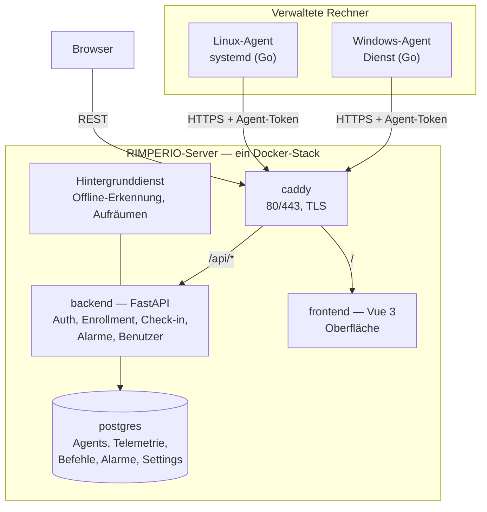
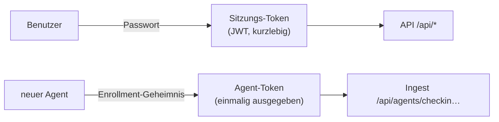
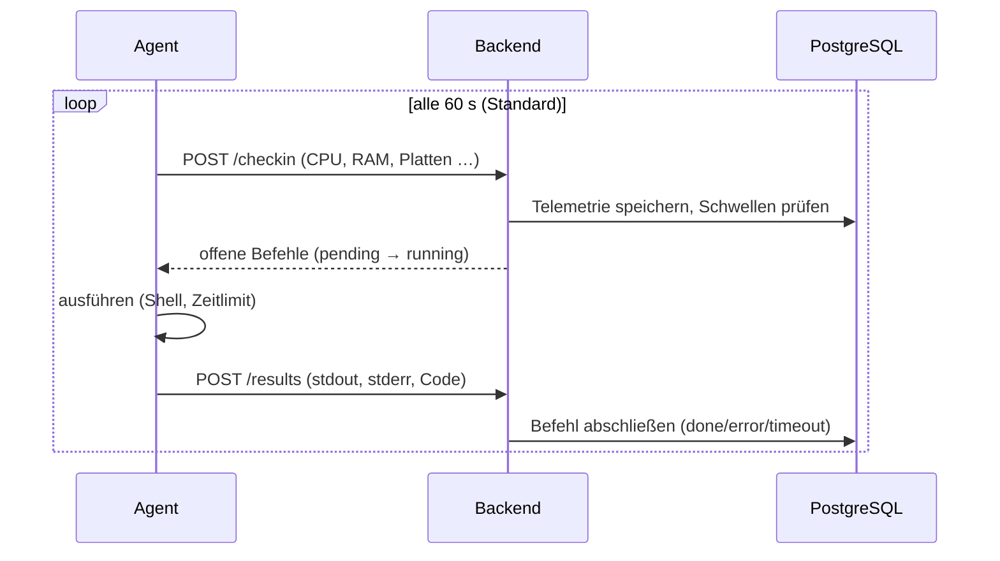

# Architektur

Wie die Teile zusammenspielen — vom Dienst auf dem verwalteten Rechner bis zur
Kachel im Browser.

← [Übersicht](../README.md) · [Bedienung](bedienung.md) · [Agent](../agent/README.md)

---

## Das Gesamtbild

---

## Datenwege

Ein Agent redet ausschließlich **ausgehend** mit dem Server — er wird nie von
außen angesprochen.

| Weg | Wer | Wie | Wohin |
|---|---|---|---|
| **Enrollment** | neuer Agent | `POST /api/agents/enroll` mit Enrollment-Geheimnis | Backend → bekommt Agent-Token |
| **Check-in** | jeder Agent | `POST /api/agents/checkin`, `Bearer <AGENT-TOKEN>`, mit Messwerten | Backend → PostgreSQL, Antwort: offene Befehle |
| **Inventur** | jeder Agent | `POST /api/agents/inventory` | Backend → PostgreSQL |
| **Ergebnisse** | jeder Agent | `POST /api/agents/results` | Backend → PostgreSQL |

Und heraus:

| Weg | Wofür |
|---|---|
| **Browser** (`/api/*`) | Dashboard, Agents, Alarme, Einstellungen |
| **OpenAPI** (`/api/docs`) | API ausprobieren und einbinden |

---

## Drei Sorten Zugang

- **Sitzungs-Token** — aus `POST /api/auth/login`, signiertes JWT, läuft ab
  (`RIMPERIO_SESSION_MINUTES`). Rollen: **admin**, **operator**, **readonly**.
- **Agent-Token** — bei der Anmeldung einmal ausgegeben, serverseitig nur als
  SHA-256 gespeichert. Darf nur einchecken, Inventur und Ergebnisse liefern.
- **Enrollment-Geheimnis** — gemeinsamer Vertrauensanker für die Erst-Anmeldung.
  Jederzeit im Browser wechselbar; bestehende Agents bleiben verbunden.

---

## Der Pull-Takt

Ein Befehl wandert so durch die Zustände: **pending** (eingereiht) →
**running** (vom Agent abgeholt) → **done** / **error** / **timeout**.

---

## Dienste und Häfen

| Dienst | Image / Bau | Port | Bemerkung |
|---|---|---|---|
| `caddy` | `caddy:2-alpine` | **80**, **443** | einziger Weg von außen; TLS automatisch bei gesetzter Domain |
| `backend` | FastAPI | 8000 *(intern)* | API, Auth, Ingest, Hintergrunddienst |
| `frontend` | Vue 3 hinter nginx | 80 *(intern)* | ausgelieferte Oberfläche |
| `postgres` | `postgres:17-alpine` | 5432 *(intern)* | nicht nach außen veröffentlicht |

---

## Alarme

Das Backend prüft jede frische Telemetrie gegen die Schwellen
([Einstellungen](bedienung.md#einstellungen)): CPU, RAM, kritischste Platte.
Der Hintergrunddienst erkennt zusätzlich **offline** (zu lange kein Check-in).
Alarme sind selbstheilend — fällt der Grund weg, werden sie automatisch
aufgelöst; von Hand auflösen geht trotzdem.

---

## Weiter

- [Bedienung](bedienung.md)
- [Agent](../agent/README.md)
- [Installer &amp; Signatur](../installer/README.md)
