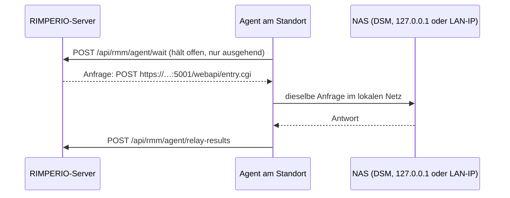

# NAS und Spezialsysteme

*Geräte → NAS & Spezialsysteme* — NAS-Systeme über ihre HTTPS-Schnittstelle (im selben Netz direkt,
[an einem anderen Standort über einen Agent dort](#nas-an-einem-anderen-standort)) und Einplatinenrechner
wie der Raspberry Pi.

← [Fernwartung](README.md) · [Alle Dokumente](../README.md)

---

## Warum über die Web-API?

Auf einem NAS lässt sich selten fremde Software installieren – jedes NAS spricht aber HTTPS.
RIMPERIO benutzt genau die Aufrufe, die auch die Weboberfläche des NAS benutzt. Nichts wird auf
dem NAS installiert, nichts geöffnet, was nicht ohnehin offen ist.

| Hersteller | Was geht |
|---|---|
| **Synology DSM** (6.2, 7.x) | voll: Zustand, Speicher, Platten, Pakete, DSM- und Paket-Updates (von Hand und im Wartungsfenster), SNMP einschalten, Hyper Backup, Konfigurationssicherung |
| **TrueNAS** (REST v2.0) | Systeminfo, Pools, Alarme, Update prüfen und einspielen (mit API-Schlüssel) |
| andere mit Weboberfläche | Erreichbarkeit und Ablauf des Zertifikats |

## Einrichten

0. **Weg wählen.** *Direkt vom RIMPERIO-Server* (selbes Netz, VPN, Portfreigabe) oder *Über einen Agent am
   Standort* – siehe [NAS an einem anderen Standort](#nas-an-einem-anderen-standort).
1. **Netzwerksuche.** Die Suche fragt jedes System mit Port 5000/5001 ohne Anmeldung nach der
   Synology-Schnittstelle (`/webapi/query.cgi?api=SYNO.API.Info`) – das beantwortet nur DSM. Erkannte
   Systeme stehen in der Netzwerksuche als „Synology DSM“ mit dem Knopf **Als NAS anbinden**, und im
   Assistenten unter *Geräte → NAS → NAS verbinden*. Eine IP von Hand geht immer.
2. **Anmelden.** Mit einem Benutzer der Gruppe *administrators* – am besten einem eigenen für RIMPERIO,
   nicht `admin`, und **mit Zwei-Faktor (TOTP)**. Ist TOTP aktiv, fragt der Assistent einmal nach dem
   Code. RIMPERIO lässt sich dabei von DSM als Gerät „RIMPERIO“ vertrauen (Geräte-Token); spätere
   Anmeldungen brauchen keinen Code mehr. Optional lässt sich das TOTP-Geheimnis hinterlegen – verwirft
   DSM das vertraute Gerät, erzeugt RIMPERIO den Code dann selbst.
3. **Prüfliste.** Direkt nach der Anmeldung prüft RIMPERIO alles und zeigt das Ergebnis:

   | Prüfung | Was |
   |---|---|
   | Erreichbar / Verschlüsselung | HTTPS (5001) oder nur HTTP (5000) |
   | Zertifikat | Aussteller, Ablauf, selbst signiert |
   | Zwei-Faktor | aktiv? (sonst Warnung) |
   | Konto | Standardkonto `admin`? |
   | Administratorrechte | dürfen Einstellungen gelesen werden? |
   | System, Speicher | Modell, DSM-Version, Pools, Volumes, Platten |
   | DSM-Update, Paket-Updates | was steht an |
   | Hyper Backup | gibt es Sicherungsaufgaben? |
   | Zugangsdaten | in Vaultwarden oder lokal verschlüsselt |
   | **SNMP v2c** | wird eingeschaltet (siehe unten) |

Die Anmeldedaten (Benutzer, Passwort, TOTP-Geheimnis, Geräte-Token) liegen in
[Vaultwarden](../integrations/README.md#vaultwarden-zugangsdaten), sonst lokal verschlüsselt.

## NAS an einem anderen Standort

Steht das NAS woanders als der RIMPERIO-Server – Filiale, Kunde, Homeoffice – ist es vom Server aus meist nicht
erreichbar. Ein VPN oder eine Portfreigabe ist dafür **nicht nötig**: Ein RIMPERIO-Agent an diesem Standort
stellt die Anfragen ans NAS im eigenen Netz und schickt die Antworten zurück. Er baut dabei nur **ausgehend
HTTPS** zum Server auf (dieselbe Verbindung, über die er ohnehin seine Befehle bekommt). Am Standort wird kein
Port geöffnet, am NAS nichts freigegeben.

Für RIMPERIO sieht das NAS danach aus wie jedes andere. Zustand, Prüfliste, Updates (auch im Wartungsfenster),
Hyper Backup und Konfigurationssicherung laufen über diesen Weg.

### Welcher Agent?

| Am Standort steht … | Agent | Adresse des NAS |
|---|---|---|
| ein Windows- oder Linux-Rechner (läuft dauerhaft) | der normale Agent auf diesem Rechner | LAN-IP des NAS, z. B. `192.168.1.20` |
| ein Raspberry Pi | der normale Agent (ARM) | LAN-IP des NAS |
| **nur das NAS** (Synology DSM 7) | **der Agent als Synology-Paket auf dem NAS selbst** | `127.0.0.1`, Port `5001` |

**Synology-Paket:** [`rimperio-agent-synology.spk`](https://github.com/Phydran6/RIMPERIO-Server/releases/latest/download/rimperio-agent-synology.spk)
– in DSM unter *Paket-Zentrum → Manuelle Installation* hochladen. DSM warnt, dass das Paket nicht von Synology
stammt; bestätigen. Der Assistent fragt nach **Server-Adresse**, **Zugangsschlüssel** (*Rechner → Agent
hinzufügen* erzeugt eine Einladung) und **Standort**. Danach meldet sich der Agent selbst an und erscheint
unter *Rechner* mit dem System „Synology DSM …“. Einzelheiten: [Synology-Paket](../../agent/installer/synology/README.md).

### Einrichten

1. *Geräte → NAS → NAS verbinden* → **Über einen Agent am Standort**.
2. Agent wählen. Läuft er auf dem NAS selbst („läuft auf dem NAS“), stehen Adresse `127.0.0.1` und Port `5001`
   schon da. Sonst die Adresse des NAS **im Netz des Agents** eintragen.
3. *Prüfen und weiter*: Der Agent fragt das NAS. Danach wie gewohnt anmelden (Konto der Gruppe *administrators*,
   Zwei-Faktor). Die Prüfliste zeigt zusätzlich den **Weg**.

Ein schon verbundenes NAS lässt sich umstellen: NAS-Seite → *Einstellungen* → *Weg zum NAS*.

### Was anders ist

| | |
|---|---|
| **SNMP** | wird wie sonst in DSM eingeschaltet, abgefragt aber vom **Agent am Standort** (das SNMP-Gerät bekommt ihn als Abfragepunkt). Eine Firewall-Freigabe (UDP 161) braucht dann der Agent statt des Servers; läuft er auf dem NAS selbst, entfällt sie. |
| **Netzwerksuche** | sucht nur im Netz des Servers. Am anderen Standort die Adresse von Hand eintragen. |
| **Agent nicht verbunden** | Das NAS steht dann auf „nicht erreichbar“ mit dem Grund *Der Agent am Standort ist gerade nicht verbunden*. Geht der Agent wieder online, liest RIMPERIO beim nächsten Takt wieder. |
| **DSM-Update mit Agent auf dem NAS** | Das NAS startet neu und der Agent mit ihm. RIMPERIO wartet, bis beide wieder antworten, und vergleicht dann die Version. |
| **Link zur DSM-Oberfläche** | entfällt (die Adresse gilt nur im Netz des Agents). |
| **Sicherungsziel „SMB-Freigabe“ auf diesem NAS** | geht nicht über den Agent (SMB ist kein HTTPS). Konfigurationssicherung und Hyper Backup des NAS selbst gehen. |
| **Weg umstellen** | *Einstellungen → Weg zum NAS*; ein vorhandenes SNMP-Gerät zieht mit. |

### Sicherheit

- Der Agent leitet nur an **lokale Adressen** weiter: private Netze, `127.0.0.1`, Link-Local, CGNAT/VPN
  (`100.64.0.0/10`). Öffentliche Adressen lehnt er ab. Geprüft wird die tatsächlich angewählte IP nach der
  Namensauflösung. Er ist also kein offener Proxy ins Internet.
- Einstellung in `agent.json`: `"relay": "lan"` (Standard), `"any"` (auch öffentliche Adressen) oder `"off"`
  (Weiterleitung aus). Die Umgebungsvariable `RIMPERIO_RELAY` hat Vorrang.
- Anfragen kommen nur vom RIMPERIO-Server, über die angemeldete Verbindung des Agents mit seinem Token. Die
  Zugangsdaten des NAS bleiben in RIMPERIO (Vaultwarden bzw. lokal verschlüsselt). Der Agent sieht sie nur in den
  Anfragen, die er weiterreicht, und speichert sie nicht.
- Höchstens 8 Anfragen gleichzeitig je Agent, Antworten bis 32 MB.

## SNMP automatisch

Bei vielen NAS ist SNMP aus. Beim Einrichten schaltet RIMPERIO über die Anmeldung **SNMP v1/v2c** ein,
mit einer zufälligen Community (nicht `public`), fragt das NAS dann selbst per SNMP und legt es unter
*SNMP-Geräte* an (Vorlagen System, Schnittstellen, Host-Ressourcen, Synology, Last). SNMPv3-Einstellungen
bleiben unverändert.

Antwortet SNMP danach nicht, blockt meist die Firewall des NAS: *Systemsteuerung → Sicherheit → Firewall* –
UDP 161 für den RIMPERIO-Server freigeben. Nachholen: Knopf *SNMP einschalten* auf der NAS-Seite.

## Zustand

Alle 10 Minuten (einstellbar): Modell, Seriennummer, DSM-Version, Laufzeit, Temperatur, CPU/RAM,
Speicherpools, Volumes (Belegung), Platten (Zustand, S.M.A.R.T., Temperatur), Pakete,
DSM-Auto-Update-Einstellung, SNMP, Hyper-Backup-Aufgaben (letzter Lauf, Ergebnis) und das Zertifikat.

Probleme werden bewertet und gemeldet (*Benachrichtigungen → NAS meldet ein Problem*, auch in der App):

| | Warnung | kritisch |
|---|---|---|
| Platte | Zustand ≠ normal, ≥ 60 °C | abgestürzt / S.M.A.R.T. „failing“ |
| Speicherpool, Volume | Zustand ≠ normal | degradiert, abgestürzt, nur lesbar |
| Belegung | ab 80 % | ab 95 % |
| Hyper Backup | letzter Lauf nicht erfolgreich | |
| Zertifikat | läuft in < 14 Tagen ab | |
| NAS | | nicht erreichbar |

## Updates

**Von Hand:** auf der NAS-Seite Pakete auswählen → *aktualisieren* (Download im Paketzentrum → Upgrade),
oder *DSM installieren* (mit dem Wort `UPDATE`: Download → Vorprüfung → Installation → Neustart →
RIMPERIO wartet, bis das NAS wieder antwortet, und vergleicht die Version).

**Automatisch** – je NAS unter *Automatik & Wartungsfenster*:

| Einstellung | |
|---|---|
| DSM-Updates / Paket-Updates | `aus` · `nur melden` · `im Fenster installieren` |
| Tage, Beginn, Dauer, Zeitzone | das Wartungsfenster |
| Hauptversionen automatisch | Standard **aus** (7.2 → 8.0 nie ohne dich) |
| Pakete nie automatisch | Liste von Paket-IDs |
| vorher Konfiguration sichern | läuft der Backup-Auftrag „NAS-Konfiguration“ vor dem Update |

Im Fenster laufen erst die Pakete, an einem späteren Fenster-Tag DSM. Neue Updates werden einmal je Stand
gemeldet (*NAS: Updates verfügbar*), Ergebnis und Fehlschlag ebenso.

> **Hinweis:** Die DSM-Web-API ist nicht vollständig dokumentiert. Jeder Vorgang schreibt deshalb sein
> Protokoll (welcher Aufruf, welche Antwort) – zu sehen unter *Vorgänge* auf der NAS-Seite. Klappt das
> Anstoßen der DSM-Installation in einer DSM-Version nicht, steht dort genau, woran es lag; das Update ist
> dann bereits heruntergeladen und lässt sich in DSM mit einem Klick fertigstellen.

## Raspberry Pi und andere Einplatinenrechner

Ein Raspberry Pi ist ein Linux-Rechner und bekommt den **normalen Agent** – damit gehen Shell,
Patchmanagement, Checks und [Sicherungen von Ordnern](../backup/jobs.md). Der Installer wählt die
Architektur selbst:

| `uname -m` | Agent | Geräte |
|---|---|---|
| `aarch64` | `linux-arm64` | Pi 3/4/5, Zero 2 mit 64-Bit-System |
| `armv7l` | `linux-armv7` | Pi 2/3/4 mit 32-Bit-System |
| `armv6l` | `linux-armv6` | Pi 1, Pi Zero (W) |

Zusätzlich meldet der Agent auf Boards das **Modell** (Device Tree), die **SoC-Temperatur** und – mit
`vcgencmd` – ob die Firmware **drosselt** (Unterspannung, Temperaturgrenze; jetzt oder seit dem Start).
Der Installer nimmt das Dienstkonto dafür in die Gruppe `video`. Übersicht unter
*Geräte → NAS & Spezialsysteme → Raspberry Pi & Spezialsysteme*, inklusive Pis, die die Netzwerksuche an der
MAC-Adresse erkannt hat, die aber noch keinen Agent haben (Einbinden per SSH aus der Netzwerksuche).

## API

| Methode | Pfad | |
|---|---|---|
| GET | `/api/nas` | Liste mit Zustand, Volumes, Updates |
| GET | `/api/nas/discovered?live=1` | als NAS erkannte Systeme der Netzwerksuche (`live` = sofort fragen) |
| GET | `/api/nas/relay-agents` | Agents, über die ein NAS an einem anderen Standort angebunden werden kann (`ready`, `on_nas`) |
| POST | `/api/nas/probe` | `{host, port?, via_agent_id?}` – was antwortet hier? (mit `via_agent_id`: vom Agent aus gefragt) |
| POST | `/api/nas/connect` | `{host, port?, username, password, otp?, totp_secret?, enable_snmp, via_agent_id?}` – 409 `need_otp: …`, wenn der Code fehlt |
| GET/PUT/DELETE | `/api/nas/{id}` | Detail (Zustand, Prüfliste, Updates, Vorgänge, `via_agent`) / Name, Intervall, Automatik, `via_agent_id` (null = direkt) / entfernen |
| POST | `/api/nas/{id}/refresh?updates=true` | neu lesen |
| POST | `/api/nas/{id}/update` | `{what: "packages", packages?}` oder `{what: "dsm", confirm: "UPDATE"}` |
| POST | `/api/nas/{id}/snmp` | SNMP v2c einschalten und als SNMP-Gerät anlegen |
| POST | `/api/nas/{id}/backup-tasks/{task}/run` | Hyper-Backup-Aufgabe starten |
| GET | `/api/nas/special` | Raspberry Pi & Co. |
